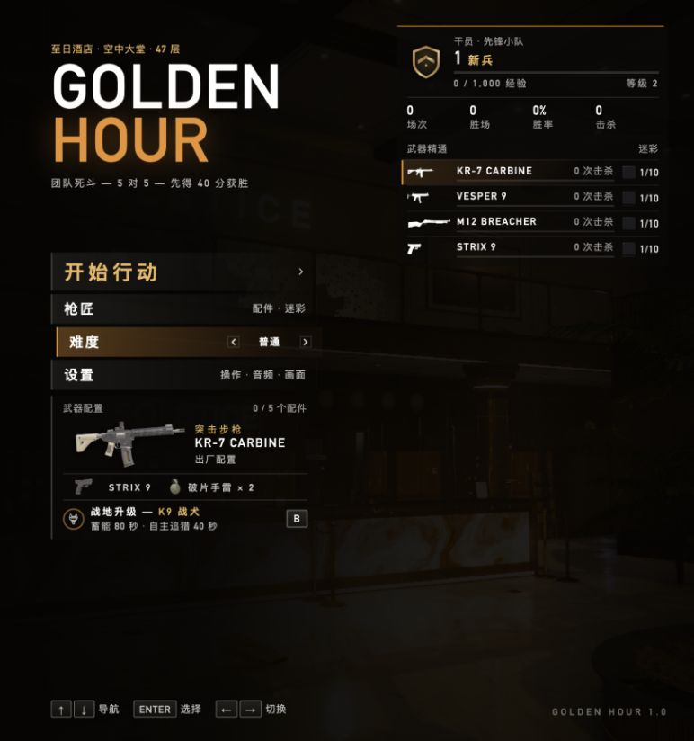
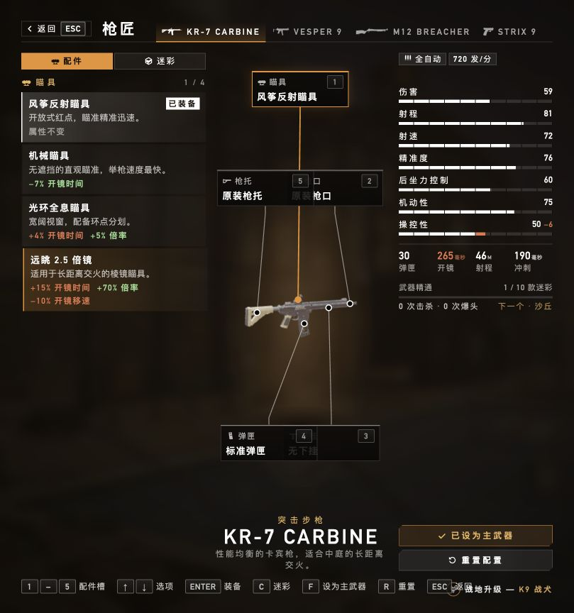
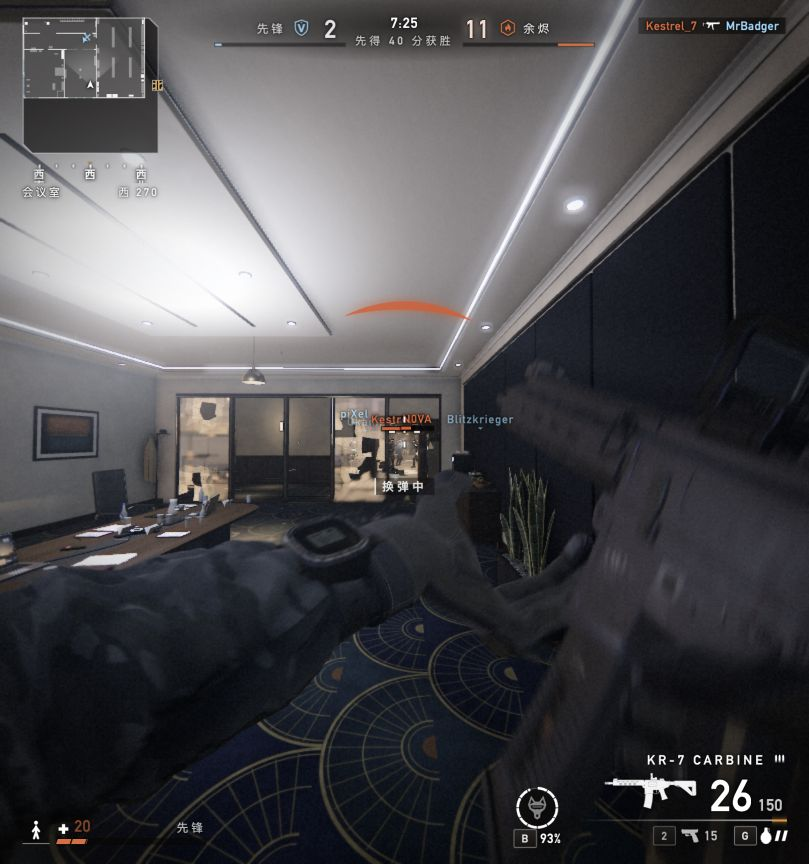

# 模块化与简体中文验收

日期：2026-11-12。基准为 `archive/published/` 中的 Claude 发布版本 `1794413451-9695`。本记录承接 [首次恢复验收](VALIDATION.md)；该历史记录中的设置页鼠标遮挡已在本轮修复。

## 代码结构与逻辑完整性

原发布脚本的 3,570 条顶层声明/语句全部分配到 85 个静态 ES 模块，包括渲染、场景、玩家、武器、AI、UI，以及引擎、音频、物理和基础设施。加上启动入口与语言模块，当前共 90 个 JavaScript 源文件。

主要类、工厂、启动变量和上下文参数已恢复可读名称；模块之间使用显式导入/导出，无循环依赖。按功能查找文件见 [开发导航](DEVELOPMENT.md)。没有升级 Three.js、改变游戏数值或重新实现玩法。

| 检查 | 结果 |
| --- | --- |
| `npm run check` | 90 个源文件语法、导入/导出、全局引用、无环依赖检查通过；归档哈希与 3 项语言测试通过 |
| `npm run verify:refactor` | 3,570 条声明/语句完整覆盖，无遗漏、重复；表达式、常量、模板/着色器和词法绑定对照通过 |
| `npm run verify:restoration` | 上述逻辑审计、原版基础 CSS 和精确 HTML 结构对照通过 |
| `npm run build` | 生产构建及 source map 成功，游戏 chunk 约 2.75 MB；保留预期的大 chunk 提示 |

声明归属、迁移和依赖检查结果见 [refactor-structure.json](refactor-structure.json)。归档文件未改动，完整性仍由 `verify:archive` 校验。

## 渲染与玩法对照

原版和模块版在同一内嵌 Chromium 中分别启动。仅隔离测试页面固定随机种子、帧步长、Date/performance 与音频时钟，采用相同视角、809 × 864 视口和原版调试输入；正常游戏不安装这些测试替身。

| 对照项 | 结果 |
| --- | --- |
| 场景节点 | 1,459 个，完整属性记录与哈希一致 |
| 几何体 | 237 个，顶点/索引等缓冲区与哈希一致 |
| 材质 | 194 个，属性记录与哈希一致 |
| 固定视角英文主菜单 | 809 × 864 截图逐像素相同，平均 RGB 绝对差为 0 |
| 部署、移动、射击、换弹、切枪 | 174 个模拟帧后的 6 个阶段快照逐项一致 |
| AI 与随机序列 | 全部 9 名机器人的队伍、代号、存活、生命值、位置及比赛分数一致；逐帧随机调用计数一致 |
| 隔离回归运行错误 | 两版均为空 |

数据见 [comparison.json](refactor/comparison.json)、[visual-comparison.json](refactor/visual-comparison.json)，完整输入与快照分别在 `tests/browser-*.js`、`docs/refactor/{baseline,current}-{scene,gameplay}.json`。

英文对照截图：[原发布版](refactor/baseline-menu.jpg)、[模块版](refactor/current-menu.jpg)。这些结果证明本次重构在受测状态下保持画面和模拟一致，不将短时截图作为性能基准。

## 简体中文

生产预览 `http://127.0.0.1:4173/` 已实际运行并验收：

- 无语言偏好时默认 `zh-CN`，页面标题、主菜单、设置、枪匠和战斗 HUD 显示简体中文。
- 设置 → 界面 → 语言可即时切换 English，实际刷新后保留英文；切回中文后保存为 `zh-CN`。
- 切换前后 KR-7 的完整武器定义相同，型号、机器人代号及存档标识保持原值。
- 经验 `0 / 1,000 经验`、配件数量、开镜时间、比分、方向和地点等动态文本正常显示。
- 中文对局实际进入 playing/live，射击后弹匣由 30 减至 26，换弹状态显示“换弹中”；暂停计分板和退出确认显示中文，双次确认后返回主菜单。
- 设置返回后，使用真实鼠标点击成功打开枪匠。修复方式仅为让隐藏页面不接收指针事件，基础样式和可见英文布局不变。

语言层只翻译显示文本和无障碍属性，保留原始英文；偏好单独存入 `golden-hour-language-v1`。品牌、枪械型号、机器人代号、场景美术标牌和部分国际单位保留原文。没有替换 HUD 的 innerHTML 或改写游戏存档格式。

结构化记录见 [language-runtime.json](refactor/language-runtime.json)。

## 验收边界

内嵌浏览器仍不支持本游戏的 Pointer Lock，生产运行记录包含浏览器的 `WrongDocumentError`。本轮射击/换弹和确定性对照使用原版 `GH.debug.key`，暂停使用原版 `input.onLockChange` 回调；没有修改生产游戏逻辑来绕过鼠标捕获。独立浏览器中的鼠标捕获及手感仍需实际游玩验收。

本轮没有覆盖完整比赛结算、全部配件/迷彩进度、各难度和 K9 完整生命周期，也没有进行移动端、跨浏览器或性能基准测试。上述原版系统的逻辑均通过逐条迁移审计，但这不替代每个功能的完整交互验收。

测试页面由 `npm run test:pages` 生成，通过 `node scripts/serve-audit.mjs` 启动隔离服务；原始游戏和正常开发页面不包含固定时钟/随机数。后续主动修改游戏逻辑时，原件等价审计出现差异是预期行为，日常开发继续使用 `npm run check` 和 `npm run build`。
