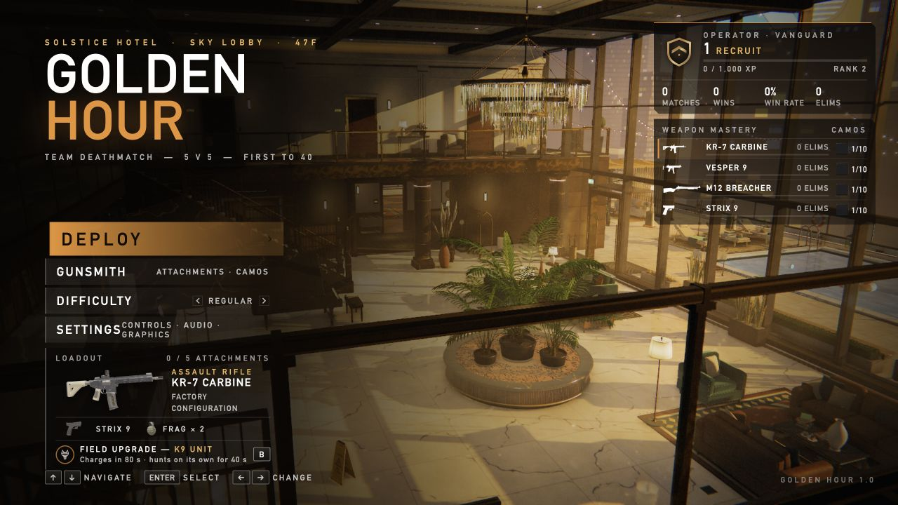
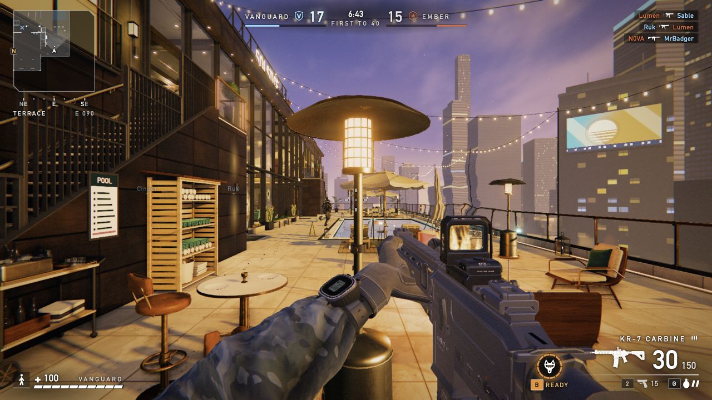
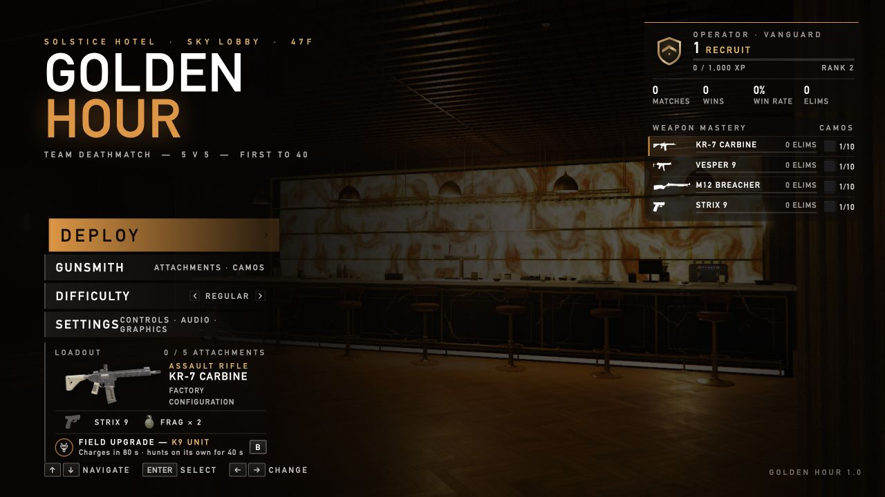

# 本地恢复验收

这是首次恢复时的历史记录。后续模块化、默认简体中文及设置页鼠标遮挡修复见 [模块化与简体中文验收](REFACTOR_VALIDATION.md)。

日期：2026-11-12。来源：[GOLDEN HOUR — Solstice Hotel](https://claude.ai/artifact/6N9gzgYJDa925a1tVxps2f)，发布版本 `1794413451-9695`。

## 原件完整性

发布接口列出两个文件，均已完整保存至 `archive/published/`：

| 文件 | 字节 | SHA-256 |
| --- | ---: | --- |
| `index.html` | 90,632 | `dce9b7eb522fde9f86f93525f6f04601d58ef5e4903ed4568b609b5981b2ce2c` |
| `dist/game.js` | 2,804,090 | `d0c07719d57a1abd72d24de675fbc600ab3816611e8f8dd8f53b236f74812a07` |

下载 HTML 后只移除 Claude 注入的 40,960 字节 frame runtime，随后大小及哈希与发布清单完全一致。没有恢复到未公开的上游多文件源码或 source map。

本地 `src/game.js` 与原件经过同一版本 Prettier 格式化后完全一致；`src/styles.css` 与原版两段样式按顺序合并、格式化后完全一致。`index.html` 精确保留原版内部空白，仅提取样式、将 title 移入 head 并替换发布加载器。

首次 HTML 自动排版曾增加文本节点，触发 HUD 的 `firstChild.insertAdjacentHTML` 启动错误。已恢复原始空白布局，加入 `.prettierignore` 和精确页面对比，最终开发版、生产版均正常启动。没有修改游戏逻辑以绕过此问题。

## 本机检查

- Node.js 26.8.2、npm 11.19.1、Vite 8.3.8、Prettier 3.10.0。
- `npm run check` 通过：JavaScript 语法与全部归档原件哈希。
- `npm run verify:restoration` 通过：完整脚本、样式和页面结构对比。
- `npm run build` 通过：生成本地 HTML、CSS、JS 和 source map。
- 生产 JS 约 2.75 MB，gzip 约 942 kB；包含原版 Three.js r180。Vite 提示 chunk 大于 500 kB，构建成功。

## 浏览器验收

使用本机 Codex 内嵌 Chromium 浏览器，分别访问开发服务 `http://127.0.0.1:5173/` 与生产预览 `http://127.0.0.1:4173/`。

| 项目 | 结果 |
| --- | --- |
| 开发版与生产版启动 | 均达到 `GH.ready === true`，进入 menu，夕阳酒店场景和标题正常渲染 |
| 原版场景数据 | 863 个碰撞体、124 块玻璃、119 个导航节点、282 条导航连接；两个运行版本的这些计数一致 |
| 设置与枪匠 | 设置、控制说明和枪匠界面可打开；武器、配件与 3D 预览可显示 |
| 部署与机器人 | DEPLOY 进入 playing/live，机器人战斗和双方计分持续更新 |
| 真实键盘移动 | W 按住 650 ms 后位置由 `[-19.85, 0, 15.45]` 变为 `[-18.42, 0, 15.44]` |
| 转向与开火 | 原版调试输入改变朝向，弹匣由 30 减至 26 |
| 完整换弹周期 | ready → reload → ready；弹匣 26 → 30，备弹 150 → 146，期间生命值维持 100 |
| 暂停与继续 | 原版 Pointer Lock 回调可进入 paused、显示暂停和计分板，并返回 playing |
| 音频 | AudioContext 为 running，音频系统 `_errors` 为空；未进行听觉品质评估 |
| 运行资源 | 两个版本的 HTTP 资源请求均来自各自的 `127.0.0.1` 服务，无远端游戏素材、字体或 API 请求 |
| 生产运行错误 | 生产启动的 JavaScript 异常记录为空，JS/CSS 均返回 200 |

生产预览的浏览器默认请求 `/favicon.ico` 返回 404；原版没有提供 favicon，不影响游戏。脚本生成的武器缩略图使用 data URL，验收记录仅保存数量，不保存图片 Base64。

## 保留的原版问题与验收边界

**设置页回退后的鼠标遮挡：** 进入 SETTINGS 再返回后，原样保留的 `.st-panel.on` 子面板会覆盖父页面的隐藏可见性，在部分区域拦截点击。实测主菜单枪匠鼠标点击被透明设置面板截获，但原版键盘 Enter 导航可以打开。该样式与归档原件完全一致，本次按恢复范围保留。刷新页面可清除此状态；本次最终保留的生产预览停在未进入设置的初始菜单。

**Pointer Lock：** 内嵌浏览器没有成功捕获鼠标，记录到两条浏览器 Pointer Lock Promise 异常。移动使用真实键盘事件；转向、开火以及暂停/继续使用原版 `GH.debug.key`、`GH.debug.look` 和 `input.onLockChange` 验证。没有更改或保存游戏调试补丁。这些检查不等于独立 Chrome 中鼠标捕获和鼠标手感的实机验收。

没有验证完整比赛结束、全部迷彩进度、每项配件、所有难度、K9 全流程、移动端或跨浏览器兼容性。截图和即时 FPS 不作为性能基准。

结构化记录见 `runtime-dev.json`、`runtime-production.json`。

## 画面

开发版主菜单：

开发版实际对局：

生产构建菜单：

